<picture>
  <source media="(prefers-color-scheme: dark)" srcset="assets/header-dark.svg">
  
</picture>

  
  
  
  

I'm a frontend engineer in Ibadan, Nigeria. Most of what I build is TypeScript UI with live data or real money behind it: React 19 and Next.js 16 day to day, Angular 21 in production, and Vue when the job needs it. I'm looking for **remote full-stack and frontend roles**.

## ⚡ Now

- 🩺 **Core contributor at AfriDam AI**, an AI dermatology platform. Since May 2026 I've led frontend across three production apps: a consumer skin-scan app and a specialist portal in Next.js 16, and a clinical annotation studio in Angular 21. In the first four months I merged **57 PRs (141 commits)** and did the final review before `main`.
- 🎓 **B.Sc. Computer Science** at the National Open University of Nigeria (in progress).

That work lives in private repos, so here are four things it involved:

| Problem | What I did |
| :-- | :-- |
| 💳 **Payment retries** | A second click on "Proceed to Payment" hit a unique constraint on the order, so the user could not pay at all. I cached the authorization URL per order so that retrying is idempotent. |
| 🔀 **A merge that would have undone 9 shipped fixes** | The branch was cut from a stale base and would have quietly reverted work from 4 merged PRs. I rebased it and kept its 3 real fixes. |
| 🔎 **Search results arriving out of order** | I added debounced server-side search, plus a guard so a slow response can't overwrite newer results. |
| 🔒 **Admin pages anyone could open by URL** | I built the app's first route-level `RoleGuard`. |

## 📦 Public work

<!--
Add when Fleet Live is published (repo + live URL), as the FIRST row of the table:

| [**Fleet Live**](https://github.com/Ola-Segun/fleet-live) |  + WebGL2 · MapLibre · Playwright A dispatcher's live map of 5,000 simulated trucks on Lagos roads, fed by GPS data that arrives late, out of order, twice or not at all. It renders trucks with raw WebGL2 on MapLibre, and replayed trucks land within 1.4 m (p95) of where the live map drew them. It also has alerts scored against simulator ground truth, 224 tests and CI. |
-->

| Project | What it shows |
| :-- | :-- |
| [**Signal Desk**](https://github.com/Ola-Segun/signal-desk) |  + Drizzle · viem (read-only) A market-research pipeline that only simulates trades. It includes a small prompt-evaluation experiment: the model echoed a score fed into its prompt, so I removed the score and a contract test keeps it out. It also has a GraphQL API that shares its service layer with REST, and a WebSocket stream that reconnects with backoff and jitter. |
| [**Portfolio**](https://olasegun.netlify.app) |  + WebGL2 · GLSL · GSAP Hand-written WebGL2 shaders in place of three.js (that layer went from ~185 kB to ~6 kB gzipped), GSAP ScrollTrigger, and a design-token system tuned separately for light and dark. |
| [**V-Topup**](https://github.com/Ola-Segun/V-Topup-app-Full-implementation) |  A mobile-first, installable bill-payment PWA for Nigerian users. A wallet is funded through several payment gateways, and transactions are tracked live. |
| [**Inventory & POS**](https://github.com/Ola-Segun/Inventory_POS_system) |  Role-based access with HttpOnly-cookie auth, plus product, order and reporting workflows. Client work. |
| [**School platform**](https://github.com/Ola-Segun/Sch-p) |  A multi-role system for admins, lecturers and students, with different authorisation rules for each role. |
| [**Accessible Learning Path**](https://github.com/Ola-Segun/accessible-learning-path) |  + TanStack Start Interactive lessons built to work with a keyboard and a screen reader. |

## 🛠️ Toolbox

<table>
  <tr>
    <td><b>Daily</b></td>
    <td>
       
      
      
      
    </td>
  </tr>
  <tr>
    <td><b>In production</b></td>
    <td>
       
      
      
    </td>
  </tr>
  <tr>
    <td><b>In public projects</b></td>
    <td>
       
      
      
      
    </td>
  </tr>
  <tr>
    <td><b>Ship with</b></td>
    <td>
      
    </td>
  </tr>
</table>
